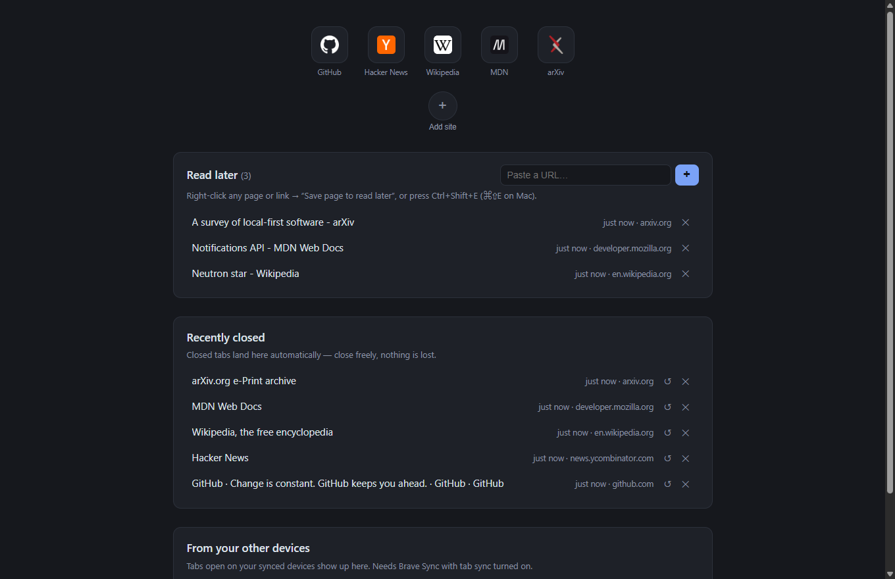

<div align="center">

# Read Later New Tab

A Brave/Chrome new tab page that works for you: a grid of pinned site tiles, a
read-later list you control, recently closed tabs, and the tabs open on your
synced devices.

Five source files, no build step, no dependencies, no network calls.

[](LICENSE)
[](https://developer.chrome.com/docs/extensions/develop/migrate/what-is-mv3)

[](#privacy)


No accounts, no cloud, no analytics.

</div>



## What it does

Four rows on every new tab.

Nothing on this page opens a tab by default. Clicking a link or a tile loads it
in this tab, the way a plain link does, so following things from here never
leaves the new tab page behind as an extra tab in the strip;
<kbd>Ctrl</kbd>/<kbd>⌘</kbd>-click or middle-click still opens a new tab when
you want one.

**1. Pinned tiles.** A grid of site icons, the way Brave's own new tab works.
Click a tile to open it, ✕ (on hover) to unpin it, drag a tile to reorder it —
the order persists. Add a site with **Add site** below the grid, or right-click
any page → **Pin to new tab tiles**. Icons come from Chrome's own favicon
cache; see *Privacy* for what that means.

**2. Read later.** Pages you save yourself. Right-click any page or link →
**Save page to read later**, press <kbd>Ctrl</kbd>+<kbd>Shift</kbd>+<kbd>E</kbd>
(<kbd>⌘</kbd><kbd>⇧</kbd><kbd>E</kbd> on Mac), or paste a URL into the box. Click
a title to open it, ✕ to dismiss. Items older than 7 days get a gentle "still
interested?" nudge. Saving from any page raises a short system notification
showing the site's name and favicon, so you get confirmation without having to
open the new tab.

**3. Recently closed.** Closed tabs land here automatically, so you can close
freely instead of hoarding tabs. ↺ reopens the tab, ✕ dismisses it. Dismisses
persist across new tabs.

**4. From your other devices.** Tabs left open on your synced devices (e.g. your
phone) show up here, via Sync's "Open tabs" data type — on desktop
`brave://settings/braveSync` → **Choose what to sync** → *Open tabs*, and the
matching setting on the phone. On mobile, just leave the tab open and it appears
on your desktop new tab page. Each row shows how long ago that tab was last seen
and its host; clicking one opens it, **+** copies it into your read-later list
(rows already in that list show **✓** instead), and **✕** dismisses it. Up to 15
tabs per device are listed.

**Background.** **Background** at the bottom of the page offers five dark
presets and **Choose image…** for a picture from your disk. A chosen image is
downscaled to 1920 px on the long side, re-encoded and stored locally, and sits
behind a scrim so the tiles and lists stay readable. **Reset** returns to the
plain dark page.

## Install

This is an unpacked extension — there is no browser-store listing, so you load
the folder yourself.

1. Get the files: `git clone https://github.com/exergonic/read-later-newtab.git`
   (or **Code → Download ZIP** and unpack it).
2. Open `brave://extensions` (or `chrome://extensions`).
3. Turn on **Developer mode** (top right).
4. Click **Load unpacked** and select this folder.
5. Open a new tab — that's it.

Requires Chromium 116 or newer (the save confirmation awaits the promise form of
`chrome.notifications`).

If you edit any file after that, click **Reload** on the extension card, or the
change will not take effect.

Optional: set the keyboard shortcut at `brave://extensions/shortcuts`. It
defaults to Ctrl+Shift+E / ⌘⇧E, chosen because Ctrl+Shift+S and ⌘⇧S are both
already taken by screenshots. Confirm it on that page — Brave's own shortcuts
cannot be enumerated from a manifest, so if Ctrl+Shift+E collides on your setup,
assign your own there. **Warning:** editing `suggested_key` in `manifest.json`
with an unaccepted combination (e.g. `Alt+Command+S`) makes the manifest
invalid and the extension silently stops loading.

## Privacy

- Storage is `chrome.storage.local` — on your disk, nowhere else.
- **The extension itself makes no network requests.** There is no analytics, no
  tracking, and no third-party favicon service.
- **Favicons are resolved by Chrome, not by this extension.** Tiles use the
  browser's built-in `_favicon/` endpoint, which serves from Chrome's own icon
  cache. The extension makes no request of its own. Two honest caveats: Chrome
  may fetch an icon from the site if it does not already have it cached (exactly
  as it does for any tab you visit), and Chrome shows a generic globe for sites
  it has no icon for.
- "From your other devices" reads tabs Brave Sync already syncs; nothing new
  leaves your machine because of this extension.
- A background image you choose is downscaled and re-encoded inside the page and
  kept in `chrome.storage.local`. It is never uploaded anywhere.
- Permissions requested and why: `storage` (your lists), `tabs` (read the
  current page's URL and title when you pin or save it), `contextMenus` (the
  right-click entries), `sessions` (Recently closed + synced device tabs),
  `favicon` (site icons in the tile grid and in the save notification),
  `notifications` (the "added to Read Later" confirmation).

## How the pieces fit

```
right-click / Ctrl+Shift+E
        │
        ▼
background.js (service worker) ──▶ chrome.storage.local
                                        │
     newtab.html + newtab.js ──renders──┘
```

The service worker owns the context-menu entries, the keyboard shortcut and the
save notification; the new tab page is a plain page that reads the same storage.
Neither makes a network request.

- `manifest.json` — MV3 manifest, new-tab override, context menus, shortcut,
  permissions.
- `background.js` — service worker: context-menu entries + shortcut → storage.
- `newtab.html` / `newtab.css` / `newtab.js` — the new tab page.
- `docs/newtab.png` — the screenshot above.

## Known rough edges

- The save notification is a `chrome.notifications` basic notification, so the
  browser will auto-dismiss it after a few seconds and Windows may group or
  suppress it under Focus Assist. Chrome rejects `data:` URLs for a
  notification's `iconUrl`, so it uses the `_favicon/` endpoint instead. Because
  Chrome ties the OS toast identity to the notification id, each save uses a
  fresh id (and clears the previous notification); a fixed id would pop only
  once, then update the entry already in the notification center silently.
- Dismisses in the "other devices" lane do not persist — they reset when you open
  a new tab. The lane reads whatever Sync currently reports, so a tab you closed
  on the phone disappears on its own, and one that is still open there comes
  back.
- A tile is reordered by dropping it on another tile: the dragged tile lands on
  the side the drop marker shows. Dropping in the gap *between* tiles does
  nothing.
- A stored background image lives in `chrome.storage.local`, so it is capped at
  1920 px on the long side and re-encoded until the copy fits in ~2.4 MB (the
  quota is about 10 MB). A file that cannot be read as an image, or that stays
  too large, is refused with a message instead of being stored. The background
  is fixed to the viewport, so it does not scroll with the page.
- `MAX_ITEMS` (200) is duplicated in `background.js` and `newtab.js`; the two
  caps could drift apart if one is edited.
- A tile's label is derived from the page title or hostname and clipped to 28
  characters, so long titles are abbreviated.

## License

MIT — see [LICENSE](LICENSE).
